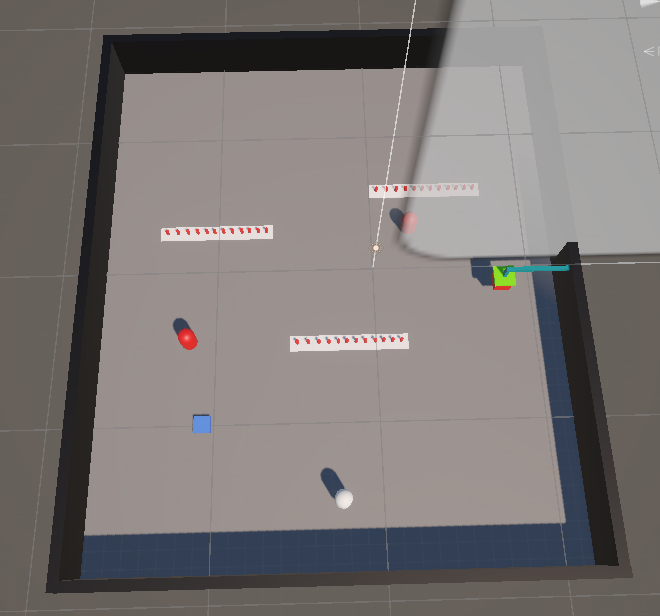
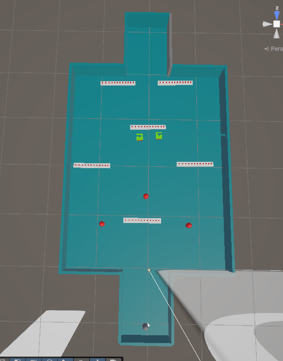
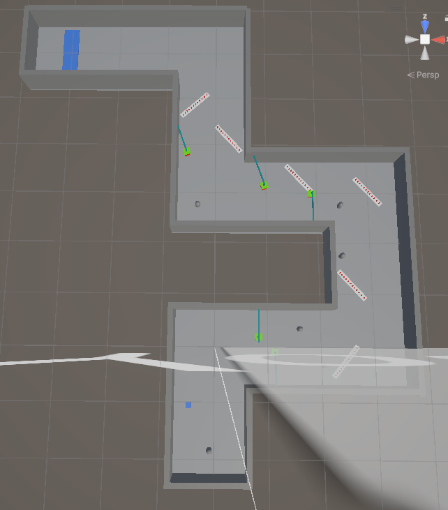
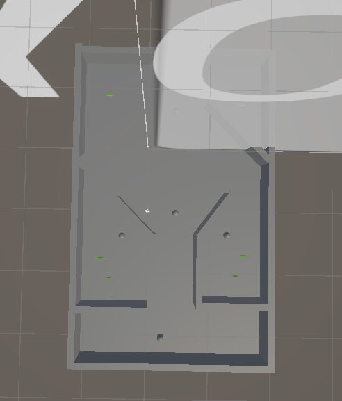
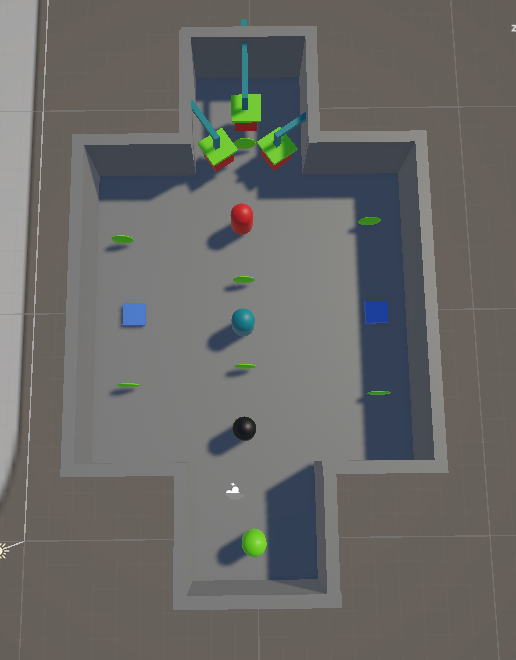

# CS464 Assignment 03 — Collect, Dodge, Survive

**Name:** [Your Name]  
**Roll Number:** BSCS25031  
**Course:** CS464 — Game Development

- **Gameplay Video (60–120 seconds):** [Watch Video](YOUR_VIDEO_LINK)
- **Started From:** [Assignment 02 Repository](https://github.com/ShadeHexSD/ITU-CS464-A2-BSCS25031)
- **Controls:** WASD / Arrow Keys to move
- **Win Condition:** Collect the required number of coins to win the level.
- **Lose Condition:** Lose all lives through hazards or falling.

## Levels

| Level | Screenshot | New Idea | Combined With |
|---|---|---|---|
| Level 01 |  | Coin collection, score and bounce pad | Basic movement |
| Level 02 |  | Spikes, damage and hearts | Coins on risky paths |
| Level 03 |  | A big Maze | Spikes, Crusher, Enemies and coins |
| Level 04 |  | Guard patrol, chase and return | Patrolling guards |
| Level 05 |  | Timed speed power-ups | All previous mechanics |

## The Numbers

| Parameter | Value | Reason |
|---|---|---|
| Patrol Speed | 2 m/s | This allows the guards to move at a reasonable speed so the player can observe their patrol routes and avoid them. |
| Chase Range | 4 m | 
The guard detects and chases the player when they come within 4 metres, giving the player a chance to avoid detection. |
| Knockback | 6, ForceMode.Impulse | An impulse applies an immediate push when the player takes damage. A force of 6 makes the hit noticeable and helps push the player away|
| I-Frames | 1 seconds | 
After taking damage, the player is protected for 1 second. This prevents continuous damage when touching spikes or enemies |
| Power-up Duration | 5 seconds | 
The speed boost lasts long enough to help the player navigate obstacles |

## Short Answers

### 1. Why does a trigger need a Rigidbody on at least one of the two objects?

Unity requires at least one of the interacting objects to have a Rigidbody for trigger events to be detected. In our game, the player has a Rigidbody, while coins and spikes use trigger colliders. This allows OnTriggerEnter() and OnTriggerStay() to detect when the player touches them.

### 2. Which ForceMode do your knockback and Part A force use, and why?

Knockback uses ForceMode.Impulse because it applies an immediate push that throws the player away from a hazard. Our bounce pad uses ForceMode.VelocityChange because it instantly changes the player's upward velocity regardless of their mass. Both forces are applied once when the relevant event occurs.

### 3. What happens when a second power-up is picked up while one is already running?

Our game uses the Refresh rule. When a second speed power-up is collected, BoostSpeed() stops the previous coroutine using StopCoroutine() and starts a new one. This resets the power-up duration to 5 seconds from the second pickup instead of stacking the durations.

### 4. Why can == fail as a waypoint arrival check, and when does it work?

Using == can fail because floating-point positions may not be exactly equal, even when an enemy is very close to its waypoint. Our EnemyPatrol.cs uses Vector3.Distance() with an arriveDistance threshold to check whether the guard has reached its destination. Exact equality can work immediately after Vector3.MoveTowards() because it snaps the position to the target when close enough.